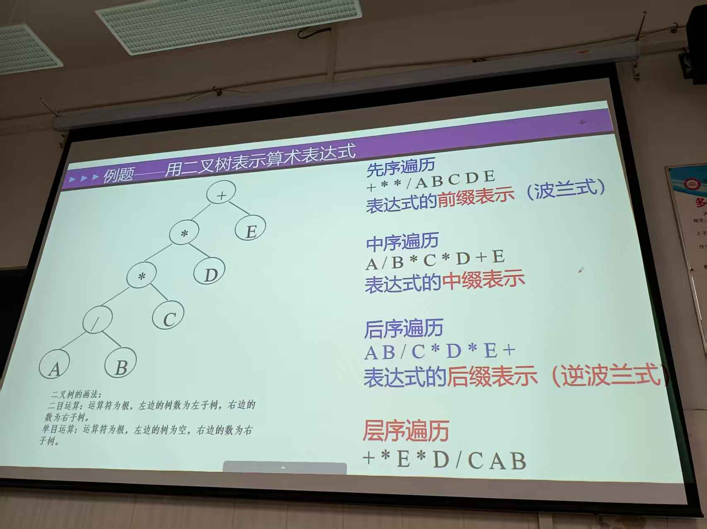

# 用二叉树表示算术表达式
任何算术表达式都能画成一棵二叉树: 运算符放内节点, 操作数放叶子.
课件里的例题就是 `A / B * C * D + E` 这一棵:


按不同顺序访问这棵树, 就得到同一个表达式的四种写法: 前缀、中缀、后缀、层序.
程序里用它来做表达式求值、编译器语法分析, 以及把中缀表达式转成机器好算的形式.

## 二叉树的画法
课件左下角给了两条规则, 这是建树的全部依据:
- **二目运算**: 运算符为根, 左边的树为左子树, 右边的数为右子树.
- **单目运算**: 运算符为根, 左边的树为空, 右边的数为右子树.

二目运算是 `+ - * /` 这类需要两个操作数的运算符; 单目运算是取负 `-x` 这类只需要一个操作数的.

优先级和结合性由树的**深度**体现: 越靠下的子树越先算. 所以 `A / B` 挂在最深处的 `/` 下面, 而整个表达式最外层是 `+`.

## 四种遍历对应四种表示

| 遍历 | 访问顺序 | 得到的结果 | 名称 |
|---|---|---|---|
| 先序 | 根 → 左 → 右 | `+ * * / A B C D E` | 前缀表示(波兰式) |
| 中序 | 左 → 根 → 右 | `A / B * C * D + E` | 中缀表示 |
| 后序 | 左 → 右 → 根 | `A B / C * D * E +` | 后缀表示(逆波兰式) |
| 层序 | 逐层, 从左到右 | `+ * E * D / C A B` | —— |

### 中缀表示必须补括号
中序得到的 `A / B * C * D + E` 直接读会误判: 乘除同级且左结合, 要还原原意得写成 `(((A / B) * C) * D) + E`.
所以**中缀表示依赖括号补优先级**, 而前缀、后缀不需要 —— 这正是它们被计算器和虚拟机采用的原因: 不用括号, 从左往右扫一遍就能算.

### 层序不能用来表示表达式
层序 `+ * E * D / C A B` 配合每层的父子关系能唯一确定这棵树, 但它**丢掉了运算符与操作数的结合结构**, 单看这串字符没法还原表达式.
它的实际用途是打印树形、按层分析.

## C# 实现

### 节点定义
```C#
// 表达式树节点: 叶子存操作数, 内节点存运算符
public class ExprNode
{
    public string Value;        // 操作数("A") 或 运算符("+")
    public ExprNode? Left;
    public ExprNode? Right;

    public ExprNode(string value, ExprNode? left = null, ExprNode? right = null)
    {
        Value = value;
        Left = left;
        Right = right;
    }

    public bool IsLeaf => Left is null && Right is null;
}
```

### 用后缀表达式建树
后缀的好处是**不需要括号、也不需要优先级判断**, 一个栈扫一遍就能建出树:
```C#
public static ExprNode BuildFromPostfix(string postfix)
{
    var stack = new Stack<ExprNode>();

    foreach (var token in postfix.Split(' ', StringSplitOptions.RemoveEmptyEntries))
    {
        if (IsOperator(token))
        {
            // 注意顺序: 先出栈的是右操作数
            var right = stack.Pop();
            var left = stack.Pop();
            stack.Push(new ExprNode(token, left, right));
        }
        else
        {
            stack.Push(new ExprNode(token));
        }
    }

    return stack.Pop();
}

private static bool IsOperator(string token) => token is "+" or "-" or "*" or "/";
```
**最常见的错**是把两个 `Pop()` 的顺序写反 —— 树会整棵左右镜像, 遍历结果全变. 后缀里操作数按"左先右后"压栈, 所以先弹出的是**右**操作数.

### 四种遍历
```C#
public static void PreOrder(ExprNode node, List<string> acc)
{
    acc.Add(node.Value);
    if (node.Left is not null) PreOrder(node.Left, acc);
    if (node.Right is not null) PreOrder(node.Right, acc);
}

public static void InOrder(ExprNode node, List<string> acc)
{
    if (node.Left is not null) InOrder(node.Left, acc);
    acc.Add(node.Value);
    if (node.Right is not null) InOrder(node.Right, acc);
}

public static void PostOrder(ExprNode node, List<string> acc)
{
    if (node.Left is not null) PostOrder(node.Left, acc);
    if (node.Right is not null) PostOrder(node.Right, acc);
    acc.Add(node.Value);
}

// 层序靠队列, 不是递归
public static List<string> LevelOrder(ExprNode root)
{
    var result = new List<string>();
    var queue = new Queue<ExprNode>();
    queue.Enqueue(root);

    while (queue.Count > 0)
    {
        var node = queue.Dequeue();
        result.Add(node.Value);

        if (node.Left is not null) queue.Enqueue(node.Left);
        if (node.Right is not null) queue.Enqueue(node.Right);
    }

    return result;
}
```
前三种用 `List<string>` 累加而不是直接 `Console.Write`, 是为了能把结果和课件上的字符串逐字比对.

### 求值
求值本质就是**后序遍历**: 先算子树的値, 再拿回来算当前节点.
```C#
public static double Evaluate(ExprNode node, Func<string, double>? lookup = null)
{
    if (node.IsLeaf)
    {
        // 有回调就查表, 否则按 A=1, B=2 ... 代入
        return lookup?.Invoke(node.Value) ?? (node.Value[0] - 'A' + 1);
    }

    double left  = Evaluate(node.Left!, lookup);
    double right = Evaluate(node.Right!, lookup);

    return node.Value switch
    {
        "+" => left + right,
        "-" => left - right,
        "*" => left * right,
        "/" => left / right,
        _   => throw new InvalidOperationException($"未知运算符: {node.Value}")
    };
}
```

### 从树还原中缀(自动补括号)
树里的结构信息是完整的, 但转成中缀给人看时必须自己补括号, 否则会退回课件那种歧义写法:
```C#
public static string ToInfix(ExprNode node)
{
    if (node.IsLeaf) return node.Value;

    // 子树是运算才加括号, 叶子不加, 免得满屏括号
    string left  = node.Left!.IsLeaf  ? node.Left.Value  : $"({ToInfix(node.Left)})";
    string right = node.Right!.IsLeaf ? node.Right.Value : $"({ToInfix(node.Right)})";

    return $"{left} {node.Value} {right}";
}
```

## 跑一遍课件那棵树
```C#
static void Main()
{
    var root = BuildFromPostfix("A B / C * D * E +");

    Print("先序(前缀)", root, PreOrder);
    Print("中序(中缀)", root, InOrder);
    Print("后序(后缀)", root, PostOrder);

    Console.WriteLine($"层序        : {string.Join(" ", LevelOrder(root))}");
    Console.WriteLine($"带括号中缀  : {ToInfix(root)}");
    Console.WriteLine($"求值(A=1..E=5): {Evaluate(root)}");
}

static void Print(string title, ExprNode root, Action<ExprNode, List<string>> walk)
{
    var acc = new List<string>();
    walk(root, acc);
    Console.WriteLine($"{title,-12}: {string.Join(" ", acc)}");
}
```
输出:
```text
先序(前缀)  : + * * / A B C D E
中序(中缀)  : A / B * C * D + E
后序(后缀)  : A B / C * D * E +
层序        : + * E * D / C A B
带括号中缀  : (((A / B) * C) * D) + E
求值(A=1..E=5): 11
```

## 单目运算怎么处理
课件的规则是"左子树为空". 画树时把 `-A` 写成 `new ExprNode("-", null, operand)` 即可, 但遍历和求值都要加一层判断:
```C#
// 单目: Left 为 null, Right 是被取负的表达式
public static double EvaluateUnaryAware(ExprNode node)
{
    if (node.IsLeaf) return node.Value[0] - 'A' + 1;

    if (node.Left is null)   // 单目
    {
        double v = EvaluateUnaryAware(node.Right!);
        return node.Value switch
        {
            "-" => -v,
            _   => throw new InvalidOperationException($"未知单目运算符: {node.Value}")
        };
    }

    return EvaluateUnaryAware(node.Left) + EvaluateUnaryAware(node.Right!); // 仅为示例, 实际按符号算
}
```
前缀和后缀都不需要为单目加括号: `- A` 和 `A -` 都能唯一识别. 只有中缀的 `-` 会同时充当二目减法和单目负号, 必须靠位置或括号区分.

## 易错点小结
- **建树时 Pop 顺序**: 先弹右、后弹左. 写反就整棵镜像.
- **中缀必须补括号**: 中序遍历的原样输出不是可执行的表达式.
- **层序遍历要队列**: 用递归写不出来, 必须配 `Queue`.
- **单目负号**: 左子树为空, 遍历和求值都要多一层判断, 否则 `Left!` 会空引用.
- **后缀与树的对应是唯一的**: 给定后缀就能唯一还原树; 但给定层序不行.
