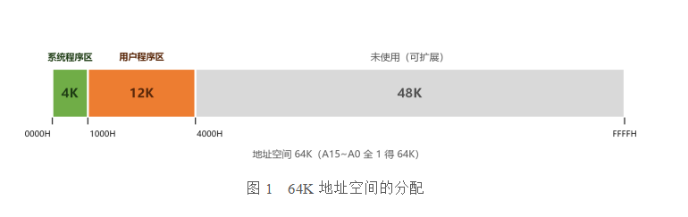

# 题目
设 CPU 共有 16 根地址线、8 根数据线，并用 MREQ（低电平有效）作访存控制信号，R/W 作读/写命令信号（高电平为读，低电平为写）。现有下列存储芯片：ROM（2K×8 位、4K×4 位、8K×8 位），RAM（1K×4 位、2K×8 位、4K×8 位），以及 74138 译码器和其他门电路（门电路自定）。
试从上述规格中选用合适的芯片，画出 CPU 和存储芯片的连接图。要求：

(1) 最小 4K 地址为系统程序区，4096~16383 地址范围为用户程序区；
(2) 指出选用的存储芯片类型及数量；
(3) 详细画出片选逻辑。

# 地址空间分析
CPU 有 16 根地址线 A15-A0，故可寻址空间为 2¹⁶ = 65536，65536/1024 = 64K, 可用地址范围为0000 0000 0000 0000~1111 1111 1111 1111转16进制为0000H-FFFFH;

系统程序区要求最小 4K，开始位置定为0000H, 截止位置为4K=4×1024=4096转16进制为1000H, 因为地址是从 0 开始编号的，第一个地址本身要占掉 1 个单元所以-1才是截止地址:
`起始地址+容量−1 == 0000H+1000H−1=0FFFH`
系统程序区截止地址为0FFFH;

应用程序区从 4096（1000H）开始，到 16383（3FFFH）结束，共 16383 − 4096 + 1 = 12288 = 12K。


# 芯片选择
系统程序区需 4K, 用户程序区需要 12K，选 RAM 4K×8 位芯片三片做字扩展。这样两区各用 4K 字长的芯片，地址低位 A11~A0 可直接送至所有芯片。

## 系统程序区
4K个存储单元（字）的个数, 有8位数据线即一个存储字有8位, 4K×8是一共需要的芯片容量, 根据所需容量判断芯片方案:
4K × 8即「字数 × 位数」;
依据以下公式来计算:
```c
字扩展倍数 = 需求字数 ÷ 芯片字数;
位扩展倍数 = 需求位数 ÷ 芯片位数;
芯片数 = 字扩展倍数 × 位扩展倍数;
```
可用的方案必须满足: 能整除 && 结果大于等于1;
各个方案的结果为:
| 芯片 | 字扩展倍数 | 位扩展倍数 | 片数 | 扩展方式 |
|---|---|---|---|---|
| 2K×8 | 4K÷2K = 2 | 8÷8 = 1 | 2 | 纯字扩展 |
| 4K×4 | 4K÷4K = 1 | 8÷4 = 2 | 2 | 纯位扩展 ✅ |
| 8K×8 | 4K÷8K = 0.5 ✗ | — | — | 芯片比需求大，淘汰 |

## 用户程序区
用户程序区需要 12K, 有8位数据线即一个存储字有8位, 12K×8是一共需要的芯片容量, 根据所需容量判断芯片方案:
各个方案的结果为:
| 芯片 | 字扩展倍数 | 位扩展倍数 | 片数 | 
|---|---|---|---|
| 4K×8 | 12K÷4K = 3 | 8÷8 = 1 | 3✅ |
| 2K×8 | 12K÷2K = 6 | 8÷8 = 1 | 6 |
| 1K×4 | 12K÷1K = 12 | 8÷4 = 2 | 24 ✗太多 |

简单来说, 优先比较各方案所需芯片数量, 当两种方案所需芯片数量相同时, 优先采用位扩展方案, 因为位扩展赢在「片选只有一路」, 片选译码逻辑更简单.

# 总体连接结构
芯片容量是2^n个单元，片内地址就需要 n 根,通常取最低的 A0-A(n-1), 低位地址用于片内寻址, 高位地址用于译码, 这是标准做法;
片内地址：每片芯片内部有 4K=2^12个单元，需要 12 根地址线，即 A0-A11 接到所有芯片的地址端;
片外地址：剩下的高位地址 A15～A12 用来参与片选译码;

## 74138译码器
硬件条件, 具备:
3个译码输入：C、B、A（C 为最高位）
8个译码输出: Y0-Y7;
3个使能端：G1（高有效）、G2A（低有效）、G2B（低有效）

译码输入接线:
A12-A15共4根线, 优先使用低位线, 把 A14、A13、A12 接到译码输入：
C ← A14
B ← A13
A ← A12

译码输出接线:
74138 译码器的译码输出线在本设计中被用作片选信号线决定“选哪一组 4K 芯片”，A11～A0 决定“选这组芯片内的哪个单元”；

高位地址A12、A13、A14已确定， 但低位地址 A11～A0 未固定，这12条线有 2^12 = 4096 = 4K 种组合，每一种组合对应一个片内存储单元也就是 4K 个连续地址；
举例:
```c
A14A13A12 固定为 001
A11～A0 从 000H 变到 FFFH，共 4K 种
对应地址：1000H ～ 1FFFH，共 4K 个连续地址
```
Y0～Y3 4根线需要选中这 4 组芯片：
ROM：4K×4 位，2片并联成 4K×8 位；
RAM：4K×8 位，3片字扩展成 12K×8 位；

系统程序区需要 4K×8 位，现有 ROM 是 4K×4 位，要凑齐8位需要进行位扩展所以需要两片 4K×4 位 ROM 并联且两片必须同时选中才能凑成 8 位，所以 Y0 要同时接 ROM1、ROM2 的片选端。

用户程序区需要 12K×8 位，现有 RAM 是 4K×8 位所以需要三片 4K×8 位 RAM 进行字扩展：
RAM1 覆盖 1000H～1FFFH；
RAM2 覆盖 2000H～2FFFH；
RAM3 覆盖 3000H～3FFFH。
由于字扩展的目的是增加存储单元数量而非增加每个单元的位数，所以字扩展每次只需要能选中一片即可，所以 Y1、Y2、Y3 分别接 RAM1、RAM2、RAM3 的片选端，不需要并联。

# 把整张图串起来
前面分别算了容量、选了芯片、接了译码器. 这一节把它们合起来看, 也就知道为什么非得这么接.

## 地址分配总表
CPU 有 16 根地址线 = 64K 空间, 本题实际只用了低 16K (0000H~3FFFH), 平分成 4 段, 每段 4K:

| 段 | 地址范围 | 容量 | 芯片 | 74138 输出 |
|---|---|---|---|---|
| 系统程序区 | 0000H~0FFFH | 4K×8 | ROM 4K×4 两片并联 | Y0 |
| 用户程序 1 | 1000H~1FFFH | 4K×8 | RAM1 (4K×8) | Y1 |
| 用户程序 2 | 2000H~2FFFH | 4K×8 | RAM2 (4K×8) | Y2 |
| 用户程序 3 | 3000H~3FFFH | 4K×8 | RAM3 (4K×8) | Y3 |

**为什么每段正好是 4K**: 片内地址用了 A11~A0 共 12 根, 2^12 = 4K.
也就是说, **段长是由片内地址的位数决定的**, 不是随便定的. 哪天换成 2K×8 的芯片, 片内地址只要 11 根, 段长就变成 2K, 整张表都得重算.

## 高位地址怎么决定「选哪一段」
A15~A12 是片外地址, 其中 A14~A12 进译码器:

| A14 A13 A12 | 74138 输出 | 选中 |
|---|---|---|
| 0 0 0 | Y0 (低有效) | ROM 组 |
| 0 0 1 | Y1 | RAM1 |
| 0 1 0 | Y2 | RAM2 |
| 0 1 1 | Y3 | RAM3 |
| 1 0 0 ~ 1 1 1 | Y4~Y7 | 未用 |

0000H~3FFFH 这 16K, 正好被 Y0~Y3 四根线瓜分完, 一根线管 4K.

## 为什么 Y0 要接两片, Y1~Y3 各接一片
两种扩展方式的目的不一样:

- **位扩展 (ROM)**: 两片 4K×4 拼成 4K×8, 一片出 D7~D4, 另一片出 D3~D0. 一次要读完整的 8 位, 必须**两片同时被选中**, 所以 Y0 同时接两片的片选端.
- **字扩展 (RAM)**: 三片 4K×8 各自负责 4K 个地址. 一次只访问一个地址, **只需要选中其中一片**, 所以 Y1、Y2、Y3 分别接三片, 不并联.

口诀: **位扩展要并联 (同时选), 字扩展要分开 (选一个)**.

## 还有两条线没接: MREQ 和 R/W
前面只解决了「选芯片」, 但要真正工作还得接这两条:

- **MREQ (访存请求, 低有效)**: 接到 74138 的使能端 G2A 或 G2B (都是低有效).
  作用: 只有 CPU 真的要访存时才让译码器工作. 平时 Y0~Y7 全部无效, 避免 CPU 访问别的设备时这 5 片存储芯片被误选, 造成总线冲突.
- **R/W (读/写, 高电平读、低电平写)**: 接到 RAM 的 WE 和 OE.
  ROM 是只读的, 只有 OE 没有 WE, 所以 **ROM 不接 R/W**; 只有 RAM 需要区分读和写.

## A15 为什么不能不管
A15 是最高位, 但译码器只有 3 个输入 (A14~A12), **A15 没进译码器**. 
如果放着不管, 那么 A15 = 1 时 (8000H~FFFFH), A14~A12 取 000 仍会让 Y0 有效 —— 访问 8000H 和访问 0000H 会选中同一片 ROM. 这就是**地址重叠**: 同一块物理存储被映射到了两个地址上.

解法: 把 A15 接到译码器另一个空着的低有效使能端. 于是:
- A15 = 0: 允许译码, 正常访问 0000H~7FFFH
- A15 = 1: 译码器整体禁用, Y0~Y7 全部无效, 8000H~FFFFH 不会被误选

这样三个使能端刚好用完: G1 接 +5V (高有效), G2A 接 A15, G2B 接 MREQ.

## 完整连接清单
| CPU 侧 | 接到 |
|---|---|
| A11~A0 | 所有芯片的地址端 (片内地址) |
| A14、A13、A12 | 74138 的 C、B、A |
| A15 | 74138 的 G2A (低有效) |
| MREQ | 74138 的 G2B (低有效) |
| G1 | +5V |
| D7~D4 / D3~D0 | ROM1 / ROM2 的数据端 (各出 4 位) |
| D7~D0 | RAM1~RAM3 的数据端 (每片都接满 8 位) |
| R/W | RAM 的 WE 与 OE |
| Y0 | ROM1、ROM2 的片选端 (并联) |
| Y1、Y2、Y3 | RAM1、RAM2、RAM3 的片选端 (各自独立) |
| Y4~Y7 | 悬空 |

## 这道题的易错点
1. **段长 4K 不是随便定的**: 由片内地址 A11~A0 决定, 换芯片容量就得重算.
2. **Y0 必须并联**: 位扩展的两片不同时选中, 读到的 8 位里就有一半是空数据.
3. **A15 不接会地址重叠**: 8000H 与 0000H 选中同一片芯片.
4. **MREQ 必须接使能端**: 不接的话 CPU 每次访问其它设备, 这些存储芯片也在被选中.
5. **74138 的输出是低有效**: 被选中那根是低电平, 不是高电平. 这个方向经常被写反.