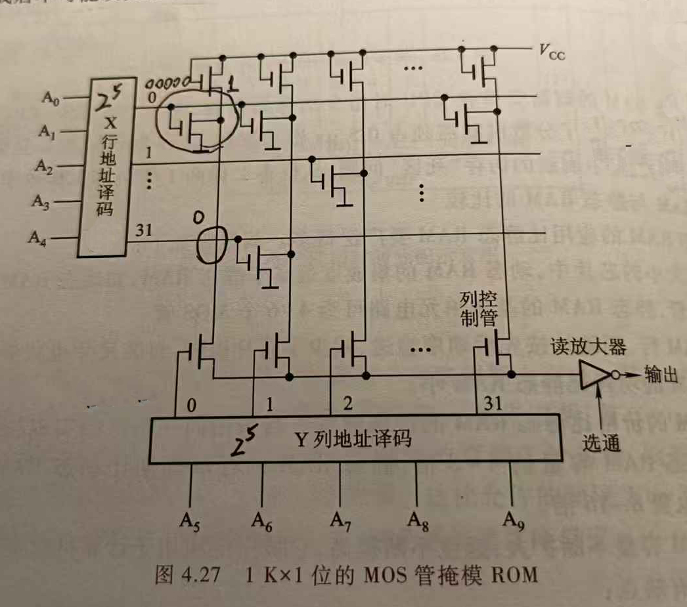
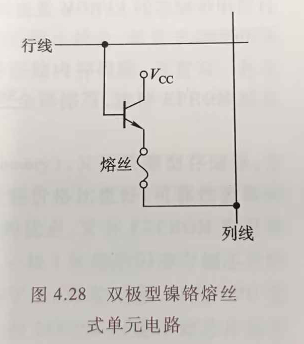
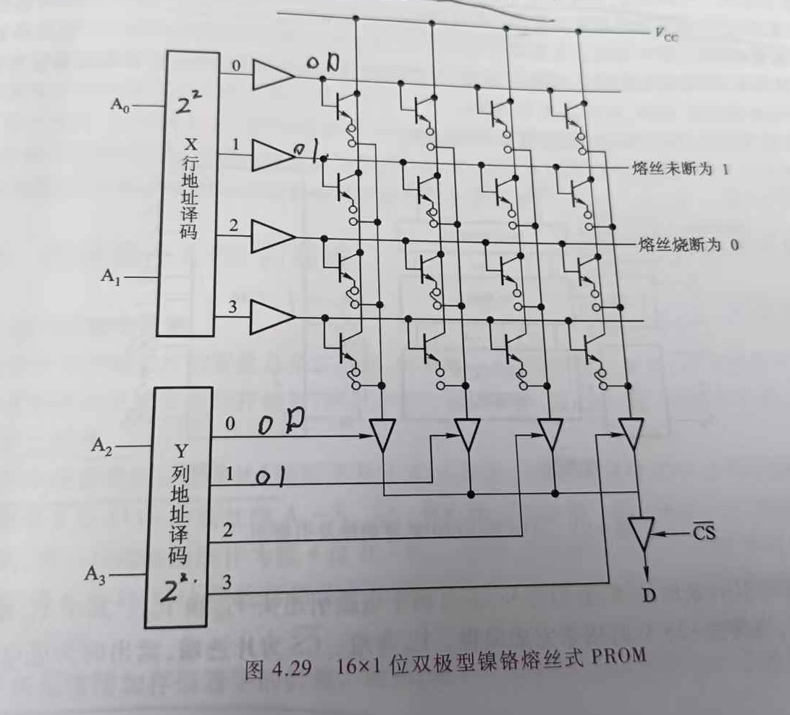
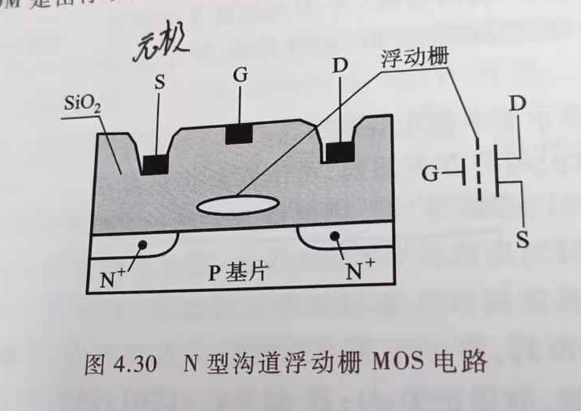

"对半导体ROM而言, 基本器件分为两种: MOS型和TTL型."

# 掩模ROM(MROM)

行选择线与列选择线交叉处可有耦合元件MOS管, 也可无.
图中行\列地址译码器分别接受5位二进制码转为十进制来确定行\列号, 进而通过坐标锁定一个耦合处.
我们可以根据耦合处是否有耦合元件MOS管区分原存1还是0;

# PROM
一种可以实现一次性编程的只读存储器.

在这个电路中, 基极(熔丝上方部分)由行线控制, 发射极与列线之间有一条镍铬合金熔丝, 熔丝熔断状态下电路输出0, 反之输出1.

图中行\列地址译码器分别接受5位二进制码转为十进制来确定行\列号, 进而通过坐标锁定一个耦合处, 根据耦合处的熔丝单元电路是否熔断来确定是0还是1;

# EPROM
EPROM是一种可擦除可编程只读存储器, 用户可以对其所存信息作任意修改. 目前用得较多的EPROM是由浮动栅雪崩注入型MOS管构成的, 又称FAMOS型EPROM.

图中所示的N型沟道浮动栅MOS电路, 在漏端D加上正电压(如25V, 50ms宽脉冲), 便会形成一个浮动栅, 它阻止源S与漏D之间的导通, 致使此MOS管处于"0"状态; 若D端不加正电压, 则不能形成浮动栅, 此MOS管便能正常导通, 呈"1"状态. 由此, 用户可对不同位置的MOS管D端施正电压或不施正电压, 便制成了用户所需的ROM.
一旦想重新改变其状态, 可用紫外线照射, 驱散浮动栅, 再按需要将不同位置的MOS管D端重新置压, 又得出新状态的ROM, 故称之为EPROM.

# 结尾
10.16 11:21