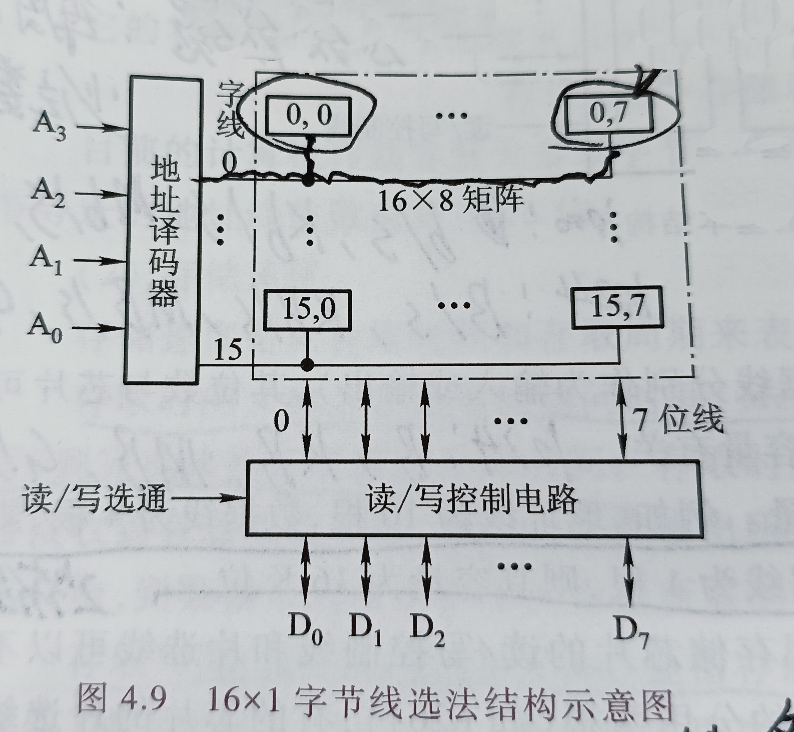
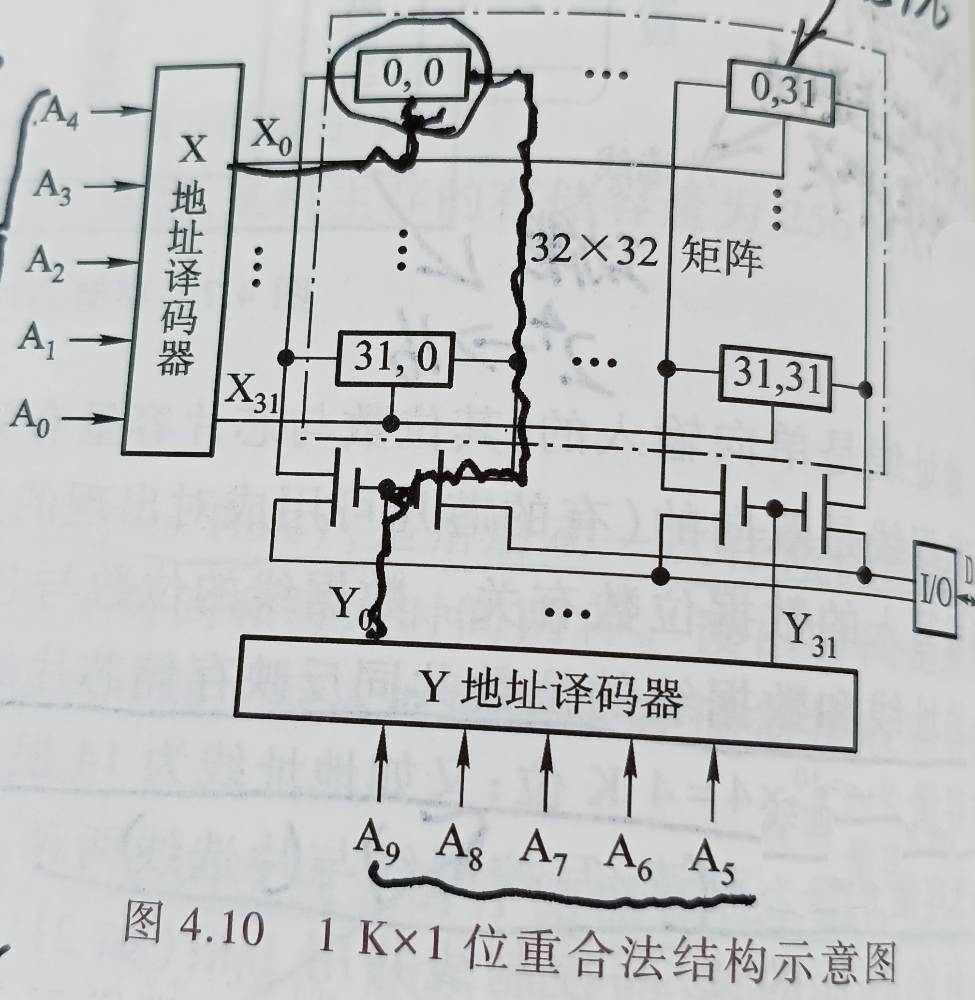
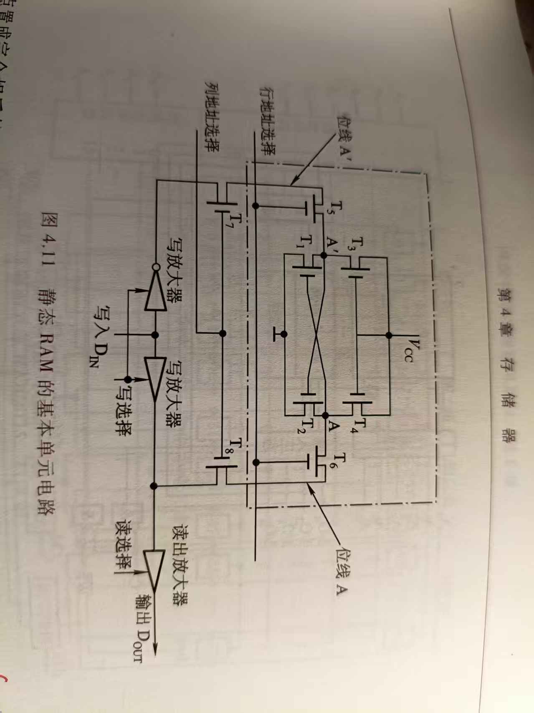
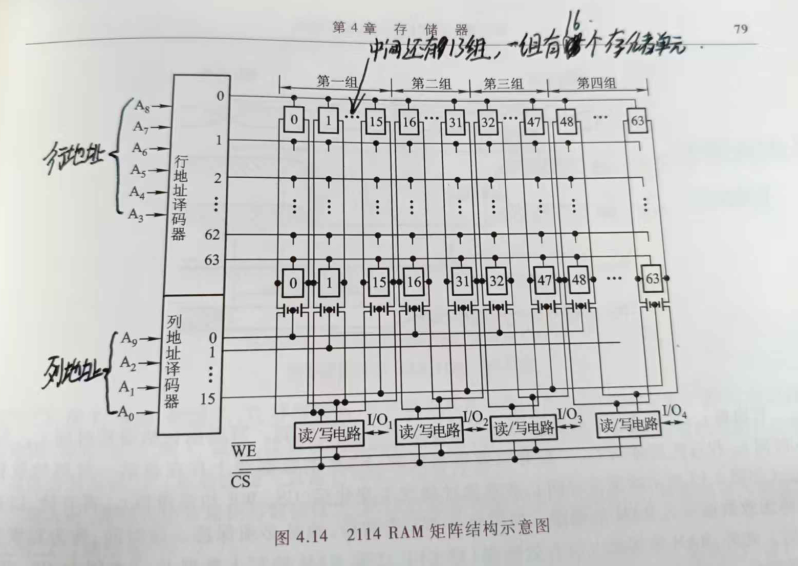
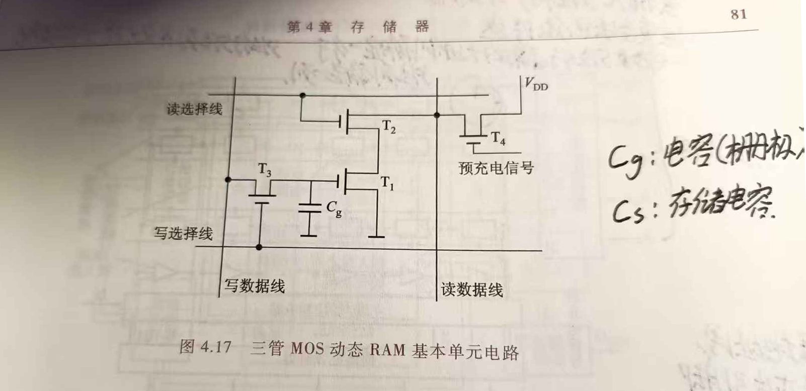
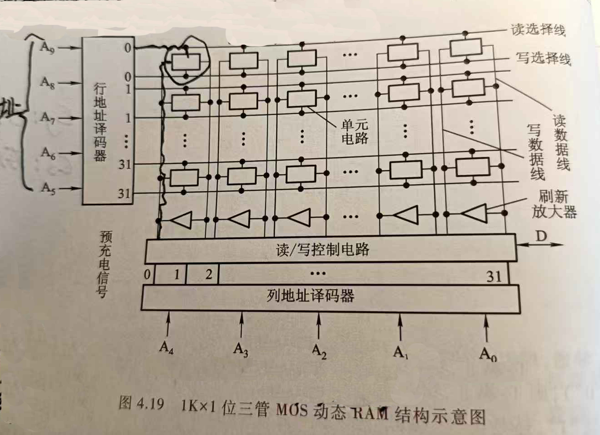

# 存储芯片的容量
地址线与数据线的位数共同反应存储芯片的容量.
```芯片容量 = 2^地址线数量×数据线数量```
n根地址线并行, 在同一时刻所有地址线共同传输同一个地址, 这个地址的所有可能的值的数量为2^地址线数量.
若将芯片看作一个坐标系, 那么以所有可用地址为纵轴, 数据位数(即数据线数量, 不用取2^数据线数量的原因是不论是1和0都占用相同的空间, 一段等长的数据不论内部排列如何占用的空间都相同?)为横轴, 他们的乘积即为该"域"的面积, 即将芯片的所有可用存储单元填满后, 芯片的容量.

把存储阵列看成二维矩阵：
行：由地址决定，一行对应一个地址。
列：由数据线决定，一列对应一个数据位。
交叉点：一个基本存储位元，存 1 bit, 大多数存储芯片（如 SRAM、DRAM）中，一个物理的基本存储单元（Basic Cell）只存储 1 位（1 bit）数据
这个理论在后面存储芯片的译码驱动方式"重合"法中有类似操作.

# 存储芯片的译码驱动方式
即存储芯片访问自身的某个存储单元的方式, 半导体存储芯片的译码驱动方式有两种: `线选法`和`重叠法`;
芯片的译码方式, 也会决定芯片的存储结构, 举例使用线选法无法访问地址分为行和列的内存, 因为无法确定列坐标.
## 线选法
芯片若是采用这种存储方式, 芯片的存储结构为一个地址对应一条字线.
地址没有被分成“行地址”和“列地址”
它的特点是用一根`字选择线(Word Line)`一维寻址：芯片内部有一个地址译码器，它将输入的n位地址直接“翻译”成2^n条字线中的某一条，使其有效。
选中整字：被选中的那条字线会连接其上的所有存储位元（Bit Cell）;
并行读写：当字线被激活，该行上所有位元会同时与数据线接通，实现一次并行读写一个完整的“存储字”（比如8位、16位）。

## 重合法
芯片若是采用这种存储方式, 芯片的内部把地址分成两部分, 高位部分负责横坐标, 低位部分负责列坐标;
这两种地址通过各自的地址译码器翻译为地址, 共同确定一位数据.


# 静态RAM基本单元电路
一种通过触发器电路存储数据的物理结构, 触发器电路输出的电平高低，就直接代表了输出数据是0还是1.
T1234这4个晶体管组成了两个反相器，交叉连在一起（像个环）,这个环就是“触发器基本电路”;

高电平代表1信号, 低电平代表0信号.
电源的作用是保持A点的电平和支持读出电压.
我们暂不讨论触发器电路是如何生成信号的(那是个物理问题), 这里只讨论信号从A点输出后如何传输.


假设触发器从A输出了"1"信号, 也就是A点为高电平.若要读出这个信号, 需要使信号抵达读出放大器, 而要完成这一目标需要T6T8全部供电; 要T6T8全部供电, 需要行、列地址选择线均有效，A点信号即可到达放大器, 在读选择信号有效时，信号“1”将进入放大器。

# 静态RAM芯片物理结构
书中以Intel2114芯片举例, 在SRAM芯片中, 每一位数据确实都是由一个双稳态触发器（交叉耦合反相器）控制的, 这就是它被称为“静态”的原因：只要不断电，触发器就会保持数据，不需要刷新.


这个图一共有 4组列组（Column Groups）, 每组里面有16列，每一列包含64个触发器（存储单元）, 有两个分别提供行地址和列地址的译码器, 基于此通过重合法来确定一位.

 <span style="text-decoration: overline;">CS</span>: 片选信号输入, 片选信号用于决定由哪一块芯片来响应数据.
 当处于低电平时，芯片被选中（激活）。此时芯片才会响应地址线（A0-A9）和控制信号，读写电路开始工作。处于（高电平）时，芯片未选中（关闭）。此时芯片的 I/O 引脚会进入高阻态（Z），与外部数据总线断开.

  <span style="text-decoration: overline;">WE</span>: 读写信号输入, 读写信号用于决定被选中的芯片是处于“读模式”还是“写模式”.
 当处于低电平时，芯片进入写入状态。外部数据(来自I/O1-I/O4)会被“写放大器”驱动，通过位线强行写入存储矩阵.
 当处于高电平时，芯片进入读取状态。写放大器关闭，读出放大器开启，将存储矩阵里的微弱电压差放大后输出到I/O 引脚。

# 动态RAM基本单元电路
 动态RAM电路基于电容存储电荷的原理来寄存信息.
 这些电容容量非常小且会持续掉电, 而持续供电并不会给这些电容充电, 因为和电源之间还隔着一个开关（晶体管）, 而当芯片处于“保持”状态（即没有读写操作）时，字线是低电平，晶体管开关是断开的, 所以即便供电状态下1-2ms就会停止运作.
 

上图是动态RAM的存储单元电路，它说明了一位数据是如何被保存、写入和读出的：**用电容存电荷，用 3 个 MOS 管控制读写**。

## 动态RAM的刷新机制
在一定时间内对动态RAM的全部基本单元电路进行一次刷新, 以防止长时间不用的单元出现数据丢失.刷新间隔(刷新周期)通常为2ms.
刷新进行的时间段, 存储单元无法访问, 称为死区(死区指的是时间段).

## MOS管的工作原理
```C++
                 栅极 G  ←── 控制线接这里
                    │
            ┌───────┴───────┐
─ 源极 S ── │   二氧化硅沟道  │ ── 漏极 D ──
            ─────────────────
```

栅极和源漏之间的沟道是一层二氧化硅，电荷根本过不去, 而给栅极加电压会在沟道处建立电场，把载流子吸引过来形成导电沟道, 源漏极之间就通了;撤掉电压，沟道消失，源漏之间就断了。
靠电场控制而不是靠电流控制，所以叫场效应管（MOSFET）。
栅极几乎不取电流, 因为绝缘，栅极上基本没有电流流过，只需要电压就能控制。
在示意图中, 这个结构使用与"电源"相同的符号表示, 其中短的是栅极，长的是沟道, 源极和漏极是从这条长线的两端各引一条线出去得到的(图中长线侧也都有两条引出线), 在任何一个时刻，两端中电位低的那一端就是源极.

## 动态RAM基本单元电路中的元件
MOS管全称`Metal（金属栅极）`-`Oxide（氧化物绝缘层）`-`Semiconductor（半导体衬底）`, 所以任何一只 MOS 管，天生就在栅极和沟道之间挂着一个电容，这就是"栅极电容".
图中`Cg`就是T1的栅极电容, 而Cg是图中唯一具备存储功能的原件.

| 器件 | 角色 | 说明 |
| --- | --- | --- |
| **Cg** | 存储节点（T1 的栅极电容） | 有电荷表示存 "1"，无电荷表示存 "0"，这是整个单元唯一"记住"数据的地方 |
| **T1** | 突出强调其存储管与读出开关 | 栅极接 Cg，源极接地。Cg 有电荷则导通，无电荷则截止，读出时靠它"表达"数据 |
| **T3** | 写选择管 | 栅极接**写选择线**，一端接**写数据线**，另一端接 Cg，负责把数据线上的电平送到 Cg |
| **T2** | 读选择管 | 栅极接**读选择线**，负责把 T1 接入读数据线，决定该列何时被读出 |
| **T4** | 预充电管（不在单元内，每列共用一只） | 受预充电信号控制，先把读数据线拉到 VDD |

## 写数据
1. 把写数据线置为要写入的电平；
2. **写选择线**电平拉高，T3 导通；
3. 数据线电平经 T3 加到 Cg 上：高电平使 Cg 充电（写 "1"），低电平使 Cg 放电（写 "0"）。

写选择线撤销后 T3 截止，电荷便被保存在 Cg 中。

## 读数据
1. **预充电信号**使 T4 导通，把读数据线充到高电平 VDD；
2. **读选择线**拉高，T2 导通，将 T1 接入读数据线；
3. 根据 Cg 是否有电荷判断：
   - Cg 有电荷（原存 "1"）→ T1 导通 → 读数据线经 T2、T1 对地放电，变为**低电平**，读出 "0"；
   - Cg 无电荷（原存 "0"）→ T1 截止 → 读数据线**保持高电平**，读出 "1"。

# 动态RAM芯片物理结构
 
 行地址译码器虽只接受5位行地址, 但共能转换出2^5种字线号, 这5位行地址转换出的字线号用于确定目标数据位的纵坐标.
 列地址同行地址, 接受5位列地址来确定一个横坐标.

# 结尾
10.15 10:43